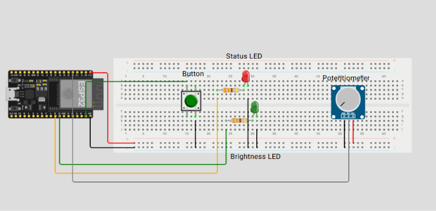

# ESP32 Structured Workstation Light

**Laboratory Activity 5: Structured Workstation Light**
Author: Gazawe Casim (GitHub: [Gazified](https://github.com/Gazified))

---

## Table of Contents

1. [Overview](#1-overview)
2. [Components](#2-components)
3. [Circuit and Wiring](#3-circuit-and-wiring)
4. [Inputs and Outputs](#4-inputs-and-outputs)
5. [Program Design](#5-program-design)
6. [The Sketch](#6-the-sketch)
7. [Demonstration Video](#7-demonstration-video)
8. [Testing and Results](#8-testing-and-results)
9. [Discussion](#9-discussion)
10. [Conclusion](#10-conclusion)
11. [How to Run the Project](#11-how-to-run-the-project)
12. [Repository Contents](#12-repository-contents)

---

## 1. Overview

This project is a hold-to-enable workstation light built on an ESP32. The brightness of an LED is controlled by a potentiometer, but the control is active only while a pushbutton is held down. When the button is released, both LEDs turn off, regardless of the knob position.

The sketch is based on Example 6 of the reference material and is organized into three separate functions for reading inputs, processing them, and updating outputs. The scaling calculation is placed in its own function, `int scaleToDuty(int raw)`.

The behavior of the system is summarized below.

| Button State | Status LED (GPIO18) | Brightness LED (GPIO19) |
|---|---|---|
| Released | Off | Off |
| Held | On | Follows the potentiometer |

---

## 2. Components

| Quantity | Component | Purpose |
|---|---|---|
| 1 | ESP32 development board | Microcontroller |
| 2 | LED | Status indicator and brightness output |
| 2 | 330 Ω resistor | Current limiting, one per LED |
| 1 | Normally open pushbutton | Enable control (Boolean input) |
| 1 | 10 kΩ potentiometer | Brightness control (numeric input) |
| 1 | Breadboard | Circuit assembly |
| Several | Jumper wires | Connections |
| 1 | USB cable | Power and programming |

---

## 3. Circuit and Wiring

All signals operate at 3.3 V. Power was disconnected while the connections were being changed, and all parts share a common ground.

| Part | Connection |
|---|---|
| Status LED | GPIO18 → 330 Ω resistor → LED anode (+); LED cathode (−) → GND |
| Brightness LED | GPIO19 → 330 Ω resistor → LED anode (+); LED cathode (−) → GND |
| Pushbutton | One leg → GPIO23; the diagonal leg → GND |
| Potentiometer | Outer pin → 3V3; other outer pin → GND; center wiper → GPIO34 |

The pushbutton uses the internal pull-up resistor of the ESP32 (`INPUT_PULLUP`), so no external resistor is needed. GPIO34 is an input-only pin without internal pull resistors, which is suitable here because the potentiometer wiper drives it directly.

### Wiring Sketch

<!-- INSTRUCTIONS: Upload your wiring sketch or schematic image to this repository (for example, in an "images" folder), then make sure the file name below matches. -->



*Figure 1. Labeled wiring of the ESP32 workstation light.*

---

## 4. Inputs and Outputs

| Type | Device | Pin | Signal | Range |
|---|---|---|---|---|
| Input | Pushbutton | GPIO23 | Digital (LOW when pressed) | 0 or 1 |
| Input | Potentiometer | GPIO34 | Analog (12-bit ADC) | 0 to 4095 |
| Output | Status LED | GPIO18 | Digital | HIGH or LOW |
| Output | Brightness LED | GPIO19 | PWM (5 kHz, 8-bit) | 0 to 255 |

---

## 5. Program Design

### 5.1 Constants, Boolean State, and Numeric Readings

| Category | Name | Use |
|---|---|---|
| Constant | `BUTTON_PIN`, `POT_PIN`, `STATUS_LED_PIN`, `PWM_LED_PIN` | Give names to the wiring. The values are fixed, so a moved wire requires a change in only one line. |
| Boolean | `buttonPressed` | `true` when the pin reads LOW. The logic is inverted because of `INPUT_PULLUP`. |
| Boolean | `pwmReady` | Stores whether `ledcAttach()` succeeded. Output is enabled only if it did. |
| Numeric | `rawInput` | The ADC reading from the potentiometer (0 to 4095). |
| Numeric | `requestedDuty` | The reading scaled to 0 to 255, which is what the knob is asking for. |
| Numeric | `appliedDuty` | The value actually sent to the LED. It equals `requestedDuty` when the button is held and 0 otherwise. |

### 5.2 Function Structure

| Function | Stage | Responsibility |
|---|---|---|
| `readInputs()` | Input | Reads the button state and the potentiometer value. |
| `scaleToDuty(int raw)` | Processing | Converts a 12-bit reading (0 to 4095) to an 8-bit duty value (0 to 255) and limits the result. |
| `processInputs()` | Processing | Calls `scaleToDuty()` and decides whether to apply the value or use zero. |
| `updateOutputs()` | Output | Sets the status LED, writes the PWM duty, and prints a status line to the Serial Monitor every 250 ms. |

### 5.3 Loop Flow

1. `readInputs()` obtains the button state and the knob reading.
2. `processInputs()` scales the reading and applies the enable decision (`buttonPressed && pwmReady`).
3. `updateOutputs()` sends the decision to both LEDs.
4. A 20 ms delay paces the loop.

The program follows the level of the button and does not count press events. Holding the button enables the output, and releasing it disables the output.

---

## 6. The Sketch

The complete sketch is saved in this repository as `Lab5_StructuredWorkstationLight.ino`. It is also shown below.

<!-- INSTRUCTIONS: Make sure the .ino file is uploaded to the repository with the same name as above. -->

```cpp
#include <Arduino.h>

const uint8_t BUTTON_PIN = 23;
const uint8_t POT_PIN = 34;
const uint8_t STATUS_LED_PIN = 18;
const uint8_t PWM_LED_PIN = 19;

bool buttonPressed = false;
bool pwmReady = false;
int rawInput = 0;
int requestedDuty = 0;
int appliedDuty = 0;

void readInputs();
void processInputs();
void updateOutputs();
int scaleToDuty(int raw);

void setup() {
  Serial.begin(115200);
  pinMode(BUTTON_PIN, INPUT_PULLUP);
  pinMode(STATUS_LED_PIN, OUTPUT);
  digitalWrite(STATUS_LED_PIN, LOW);
  pinMode(PWM_LED_PIN, OUTPUT);
  digitalWrite(PWM_LED_PIN, LOW);
  analogReadResolution(12);
  analogSetPinAttenuation(POT_PIN, ADC_11db);
  pwmReady = ledcAttach(PWM_LED_PIN, 5000, 8);
  if (pwmReady) {
    ledcWrite(PWM_LED_PIN, 0);
  } else {
    Serial.println("PWM setup failed.");
  }
}

void loop() {
  readInputs();
  processInputs();
  updateOutputs();
  delay(20); // Pause for 20 ms between loop iterations.
}

// ---------- INPUT ----------
void readInputs() {
  buttonPressed = (digitalRead(BUTTON_PIN) == LOW);
  rawInput = analogRead(POT_PIN);
}

// ---------- PROCESSING ----------
int scaleToDuty(int raw) {
  return (int)constrain(map(raw, 0, 4095, 0, 255), 0L, 255L);
}

void processInputs() {
  requestedDuty = scaleToDuty(rawInput);
  if (buttonPressed && pwmReady) {
    appliedDuty = requestedDuty;
  } else {
    appliedDuty = 0;
  }
}

// ---------- OUTPUT ----------
void updateOutputs() {
  digitalWrite(STATUS_LED_PIN, (buttonPressed && pwmReady) ? HIGH : LOW);
  if (pwmReady) {
    ledcWrite(PWM_LED_PIN, appliedDuty);
  }

  // Serial report every 250 ms for recording results
  static unsigned long lastPrint = 0;
  if (millis() - lastPrint >= 250) {
    lastPrint = millis();
    Serial.printf("button=%d raw=%d requested=%d applied=%d\n",
                  buttonPressed, rawInput, requestedDuty, appliedDuty);
  }
}
```

---

## 7. Demonstration Video

https://drive.google.com/file/d/17uBMUx_QYdvwHT3DOnkzGmqRQWn2yNpH/view?usp=sharing


The video demonstrates the following:

1. The circuit and its labeled connections.
2. Reset with the button released, with both LEDs off.
3. Rotation of the knob while the button is released, with both LEDs remaining off.
4. The button held, with the status LED turning on.
5. Rotation of the knob while the button is held, with the brightness changing.
6. The button released, with both LEDs turning off.


---

## 8. Testing and Results

The Serial Monitor was set to 115200 baud. Each line has the format `button=<0/1> raw=<0-4095> requested=<0-255> applied=<0-255>`, where `button=1` means the button is held.

### 8.1 Required Tests: Expected versus Observed

| # | Test | Expected Behavior | Observed Behavior | Result |
|---|---|---|---|---|
| 1 | Reset with the button released | Both LEDs off; `applied=0` | `button=0 raw=4095 requested=255 applied=0` on all 12 readings. LED observation:  | Pass |
| 2 | Hold the button | `button=1`; status LED on; `applied` equals `requested` | `button=1 raw=4095 requested=255 applied=255`. LED observation:  | Pass |
| 3 | Rotate the knob while held | Brightness changes with the knob | `raw` fell from 3918 to 0 while `applied` fell from 243 to 0 (see Section 8.3). LED observation:  | Pass |
| 4 | Release the button | Both LEDs off immediately | `applied` dropped to 0 while `raw` and `requested` stayed unchanged (for example, `raw=1275 requested=79 applied=0`). LED observation:  | Pass |
| 5 | Rotate the knob while released | Both LEDs stay off at every knob position | Across a full sweep from `raw=0` to `raw=4095` and back, `applied=0` on every line. LED observation:  | Pass |

### 8.2 Low, Middle, and High Knob Positions (Button Held)

| Knob Position | Expected Raw | Expected Duty | Observed Reading | Duty (%) | Result |
|---|---|---|---|---|---|
| Low | About 0 | About 0 | `button=1 raw=0 requested=0 applied=0` | 0.0 | Pass |
| Middle | About 2048 | About 127 | `button=1 raw=2021 requested=125 applied=125` | 49.0 | Pass |
| High | About 4095 | 255 | `button=1 raw=4095 requested=255 applied=255` | 100.0 | Pass |

The middle reading of 2021 is slightly below the nominal 2048 because the knob could not be set to an exact position.

### 8.3 Knob Sweep While the Button Was Held

| Raw Reading | Requested Duty | Applied Duty | Duty (%) |
|---|---|---|---|
| 3918 | 243 | 243 | 95.3 |
| 3408 | 212 | 212 | 83.1 |
| 3328 | 207 | 207 | 81.2 |
| 2021 | 125 | 125 | 49.0 |
| 1465 | 91 | 91 | 35.7 |
| 451 | 28 | 28 | 11.0 |
| 0 | 0 | 0 | 0.0 |

### 8.4 Selected Readings While the Button Was Released

| Raw Reading | Requested Duty | Applied Duty |
|---|---|---|
| 0 | 0 | 0 |
| 352 | 21 | 0 |
| 1429 | 88 | 0 |
| 2512 | 156 | 0 |
| 3907 | 243 | 0 |
| 4095 | 255 | 0 |
| 2559 | 159 | 0 |
| 645 | 40 | 0 |

The knob continued to produce requested values from 0 to 255, but the applied value remained 0 in every case.

### 8.5 Scaling Check

The `scaleToDuty()` function uses integer arithmetic, so the result is truncated.

| Raw | Calculation | Result |
|---|---|---|
| 0 | 0 × 255 ÷ 4095 | 0 |
| 2021 | 2021 × 255 ÷ 4095 = 125.8 | 125 |
| 4079 | 4079 × 255 ÷ 4095 = 254.0 | 254 |
| 4095 | 4095 × 255 ÷ 4095 | 255 |

All observed `requested` values matched this calculation.

---

## 9. Discussion

The results show that the enable decision works as intended. While the button was released, the potentiometer was still read and scaled, as shown by the changing `raw` and `requested` values, but the applied duty stayed at 0. This confirms that the knob does not light the output unless the button is held.

The scaling function produced the expected values at the low end, the middle, and the high end of the range. Raw readings fluctuated by a few counts between samples, which is normal for the ESP32 ADC. In the final line of the recorded data, the button was held with the knob at its minimum position. The output was enabled but the duty was 0, so the LED remained off.

During testing, the button initially read `0` at all times, even when it was not pressed. The cause was a wiring error in which the two connections were placed on legs of the same side of the pushbutton, which are already connected inside the component. The problem was corrected by moving the ground connection to the diagonal leg, after which the button read `1` when released and `0` when pressed.

The control follows the button level, so it is a hold-to-enable design and not a latched safety control. If the button is held during startup, the output is enabled on the first loop.

---

## 10. Conclusion

The workstation light met all of the required behaviors. Both LEDs stayed off after reset with the button released, the output was enabled while the button was held, the brightness changed with the knob during the hold, and both LEDs turned off when the button was released. Separating the code into input, processing, and output functions, and placing the scaling in `scaleToDuty()`, made the program easier to read and test.

---

## 11. How to Run the Project

1. Assemble the circuit according to Section 3.
2. Install the Arduino IDE and the ESP32 board package. The `ledcAttach()` function requires version 3.x of the Arduino-ESP32 core.
3. Open `Lab5_StructuredWorkstationLight.ino`.
4. Select the ESP32 board and the correct COM port, then upload the sketch.
5. Open the Serial Monitor at 115200 baud.
6. Hold the button and turn the knob to change the brightness. Release the button to turn both LEDs off.

---

## 12. Repository Contents

| File or Folder | Description |
|---|---|
| `README.md` | Project documentation |
| `Lab5_StructuredWorkstationLight.ino` | Arduino sketch |
| `images/wiring-sketch.png` | Labeled wiring sketch |
| Demonstration video | Linked in Section 7 |

---

## Reference

ESP32 Series Datasheet, v5.3. Pin restrictions for GPIO34 to GPIO39 were taken from this document through the laboratory reference material.
